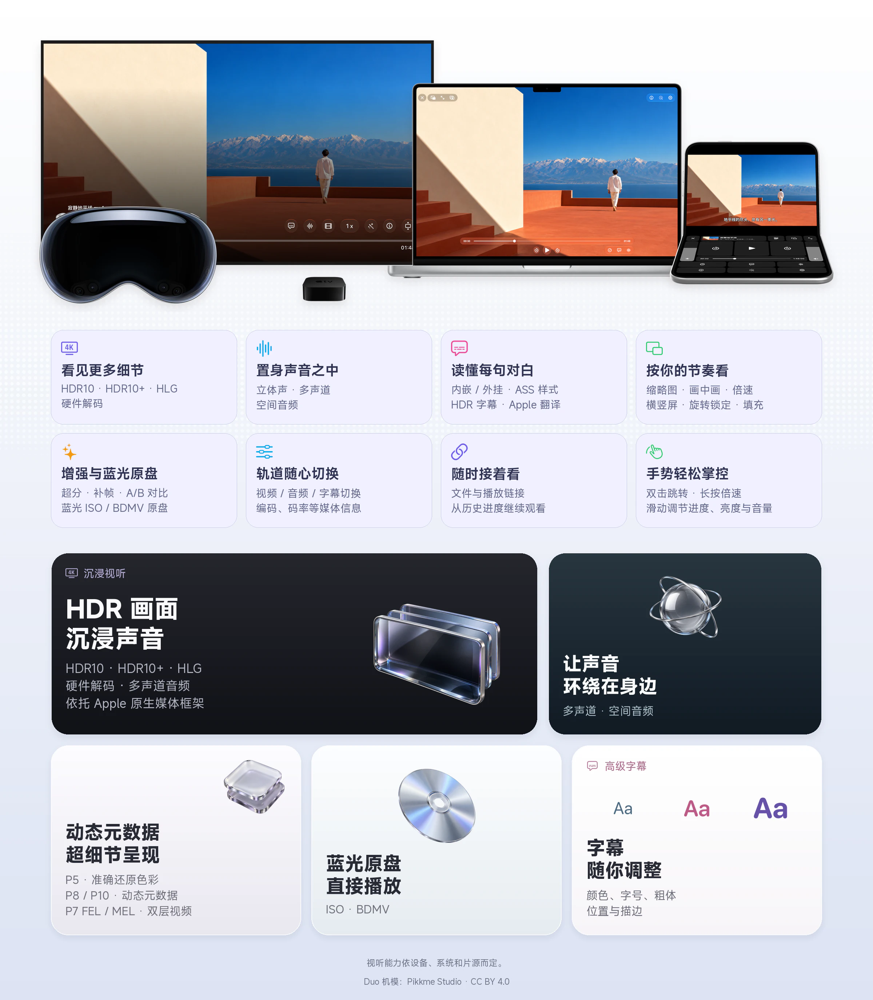

<div align="center">
  <a href="https://cinemore.com.cn/">
    
  </a>
  <h1>CinePlayer for Apple</h1>
  <p><strong>为你的媒体打造的原生播放器</strong></p>
  <p>
    <a href="README.md">English</a> · <a href="README-zh.md">简体中文</a>
  </p>
  <p>
    <a href="https://apps.apple.com/cn/app/cineplayer/id6759988668">
      
    </a>
  </p>
</div>

CinePlayer 是面向 iPhone、iPad、Mac、Apple TV 和 Apple Vision Pro 的独立视频播放器。打开自己的视频，调整字幕与轨道，随时从历史进度继续观看。

应用层开源，基于 **[Cinemore](https://cinemore.com.cn)** 使用的 `CinePlayerSDK` 播放内核构建，提供 HDR、多声道与空间音频、蓝光原盘播放和视频增强，并使用各平台的原生交互界面。

## 📸 预览

<p align="center">
  <a href="assets/cineplayer-overview-zh.webp"></a>
</p>

播放画面为示例，请自行添加媒体；CinePlayer 不提供影视内容。视听能力依设备、系统和片源而定。

Duo 机模由 [Pikkme Studio](https://sketchfab.com/3d-models/iphone-duo-3d-model-by-pikkme-studio-d2ca6bff92c141d1b1c5759b19d533e0) 制作，按 [CC BY 4.0](https://creativecommons.org/licenses/by/4.0/) 许可调整姿态与白色外观。

## ✨ 特性

- **打开与续播**：本地文件、播放链接与历史进度续播；Apple TV 通过播放链接打开视频。
- **画质与音频**：HLG、HDR10、HDR10+、杜比视界（含 RPU）；硬件解码；立体声/多声道、空间音频、杜比全景声（在支持场景下）。
- **手势与快捷键**：iOS — 单击显隐控制、双击左右快进/快退或中间播放/暂停、长按临时倍速（播放设置中可配置快进秒数与长按倍速）；tvOS — 遥控器滑动/按键快进快退、长按连续快进；macOS — 空格播放/暂停、方向键快进/倍速、Esc 全屏、鼠标移动唤起控制层。
- **字幕**：内嵌与本地外挂字幕；按字幕格式提供文字或图片样式调整；HDR 字幕亮度；iOS/macOS Apple 翻译、目标语言及双语上下顺序设置。
- **轨道与媒体信息**：音视频与字幕轨道列表快速切换；媒体信息详情卡片。
- **画面增强**：Anime4K、MetalFX、FSR、ArtCNN 超分，VideoToolbox、MetalFX、RIFE 补帧，以及杜比视界 P7 FEL 解码开关。可用选项取决于系统、设备和当前视频；FSR/ArtCNN 限 SDR、1080p 像素量及以下、最高 30 fps；RIFE 不用于 tvOS。超分支持 A/B 对比，准备期间继续显示原帧。
- **播放体验**：进度条拖动带缩略图预览、画面填充、倍速调节；iOS 横竖屏与旋转锁定；支持平台的画中画；macOS 全屏与窗口置顶；支持系统的锁屏与控制中心 Now Playing 控制。
- **蓝光**：ISO、BDMV。
- **平台**：iOS、macOS、tvOS、visionOS。
- **原生界面**：tvOS 遥控器菜单和字幕调整；visionOS 独立播放窗口、Ornament 控制面板与沉浸环境；支持系统分区的 iOS 27.1 设备可分开展示画面和控制台。

**杜比视界及杜比全景声由 Apple AVFoundation 的 [AVPlayer](https://developer.apple.com/documentation/avfoundation/avplayer/) 负责处理。**

## 安装

### Homebrew Cask（macOS）

```bash
brew install --cask cinemore/tap/cineplayer
```

从 v2.0.0 起，[GitHub Releases](https://github.com/cinemore/CinePlayer/releases) 中的 macOS 构建均使用 Developer ID 签名并通过 Apple 公证。Homebrew 分发同一个同时支持 Apple Silicon 和 Intel Mac 的通用应用包。

### App Store

iPhone、iPad、Apple TV、Apple Vision Pro，以及 App Store macOS 版本，请使用上方 App Store 链接安装。

## 🏗 项目架构与依赖

### 核心播放内核 (Closed Source)

* **CinePlayerSDK:** 本项目的核心播放引擎。它是一个闭源的商业组件，仅以二进制形式提供。
* **Frameworks:** 预编译 SDK 与第三方 framework 二进制以 [v2.0.0 Release 中的 Frameworks.zip](https://github.com/cinemore/CinePlayer/releases/download/v2.0.0/Frameworks.zip) 分发。下载配套 bundle 和校验文件，校验后解压到仓库根目录：

```bash
curl --fail --location -O https://github.com/cinemore/CinePlayer/releases/download/v2.0.0/Frameworks.zip
curl --fail --location -O https://github.com/cinemore/CinePlayer/releases/download/v2.0.0/Frameworks.zip.sha256
shasum -a 256 -c Frameworks.zip.sha256
unzip Frameworks.zip
bun scripts/verify-frameworks.ts
```

解压后，仓库中应包含 `Frameworks/CinePlayerSDK.xcframework`、`Frameworks/CineFFmpeg.xcframework` 等路径。

v2.0.0 bundle 包含此版本所需的全部 18 个 XCFramework。校验脚本检查四个平台和模拟器 slice，以及关闭、字幕翻译、异步字幕加载、帧回调等公开接口。

应用层保持独立播放器边界：本地文件、URL、历史记录、播放控制、轨道、字幕与增强；不包含 Cinemore 的账号、媒体库、云盘、剧集、资源切换或投屏服务。

## 📚 第三方库列表 (Third-party Libraries)

CinePlayer 的强大功能离不开以下优秀开源项目的支持：

### 核心多媒体框架

* **[FFmpeg](https://github.com/FFmpeg/FFmpeg)**

### 视频与 HDR 处理

* **[dav1d](https://github.com/videolan/dav1d)** (libdav1d)
* **[dovi_tool](https://github.com/quietvoid/dovi_tool)** (libdovi)
* **[uavs3d](https://github.com/uavs3/uavs3d)** (libuavs3d)
* **[Anime4KMetal](https://github.com/cinemore/anime4k-metal)** 0.1.4
* **[RifeMetal](https://github.com/cinemore/rife-metal)** 0.1.8（iOS/macOS/visionOS）
* **[FSRMetal](https://github.com/cinemore/fsr-metal)** 0.1.0
* **[ArtCNNMetal](https://github.com/cinemore/artcnn-metal)** 0.1.0

视频增强许可随应用打包，也可在「关于 → 视频增强许可」查看。

### 字幕渲染引擎

* **[libass](https://github.com/libass/libass)**
* **[FreeType](https://github.com/freetype/freetype)**
* **[FriBidi](https://github.com/fribidi/fribidi)** 
* **[HarfBuzz](https://github.com/harfbuzz/harfbuzz)** 
* **[libunibreak](https://github.com/adah1972/libunibreak)** 

### 蓝光支持

* **[libbluray](https://code.videolan.org/videolan/libbluray)** 
* **[libudfread](https://code.videolan.org/videolan/libudfread)**
 
## 🧪 构建与代码签名

在 iOS 真机上运行时，请在 Xcode 中打开 `CinePlayer` iOS Target 的 **Signing & Capabilities**，选择你自己的 **Team**。其他设置保持默认即可用于本地开发。

构建前请先按「项目架构与依赖」中的说明准备配套 `Frameworks.zip`。当前 SDK 使用 Swift 6.4 编译，验证环境为 Xcode 27；Swift Package 版本固定在 `Package.resolved`。

发布 macOS 版本时，先使用 Developer ID 签名导出归档，完成公证并附加票据，再生成 ZIP。在本地运行 `bun scripts/verify-macos-release.ts v<版本号> <产物目录>`，校验文件哈希、应用版本、签名和公证票据。将 `CinePlayer-macOS-v<版本号>.zip`、配套的 `Frameworks.zip` 及各自的 `.sha256` 文件上传到 GitHub Releases，再更新 `cinemore/homebrew-tap` 仓库中 `Casks/cineplayer.rb` 的版本号和校验值。发布与 Homebrew 更新均手动完成。

`CinePlayerTests` 是跨平台测试 scheme，覆盖真实媒体播放、暂停定位、换轨、字幕加载失败、换片/关闭、缩略图及增强资源清理；macOS 另有 FSR/ArtCNN GPU 输出测试。测试 scheme 使用内存历史库，不写入日常播放历史。

## ⚖️ 授权协议 (License)

本项目采用混合授权模式：

* **源码许可**：见仓库根目录的 [`LICENSE`](LICENSE) 文件。
* **SDK 许可**：CinePlayerSDK 的**正式条款**以各平台 slice 内 `CinePlayerSDK.framework` 中的 **License** 文件为准（macOS 下路径为 `Versions/A/Resources/License`）。完整路径：`Frameworks/CinePlayerSDK.xcframework/<平台>/CinePlayerSDK.framework/...`。

本仓库所引用的第三方库（FFmpeg、libass 等）均依各自许可证使用，见上文「第三方库列表」中的链接。

### 1. 开源部分

**CinePlayer** 应用层源码基于 **[Apache License 2.0](https://www.apache.org/licenses/LICENSE-2.0)** 协议开源。你可以自由地学习、修改并基于本仓库代码开发自己的应用。

### 2. 闭源组件与商业授权

**CinePlayerSDK**（通过 GitHub Releases 分发的预编译二进制）为专有软件，**正式条款**以 SDK 内 License 文件为准。禁止对 SDK 二进制进行逆向工程、反编译或反汇编。

**仅针对本仓库**，授权方允许：

* **仅允许个人使用**：`CinePlayerSDK` 仅限个人使用。未经书面许可不得再分发、再许可或用于商业用途。
* **商业用途**：任何第三方公司**严禁**在未获书面许可前将 `CinePlayerSDK` 用于商业产品。
* **商业授权**：商业使用或再分发权利请联系：`cinemore@cinemore.com.cn`。
