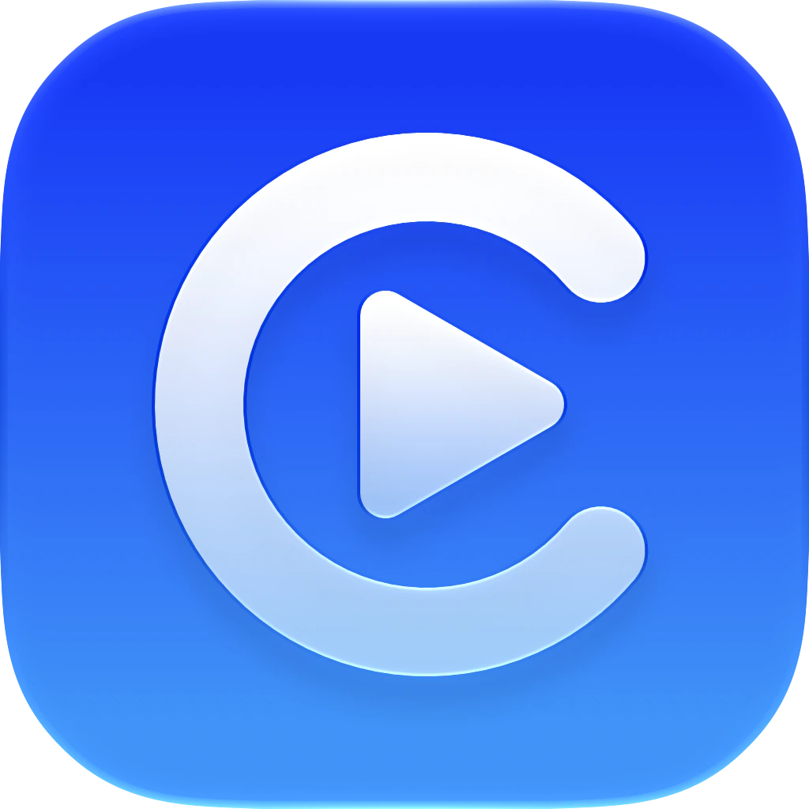
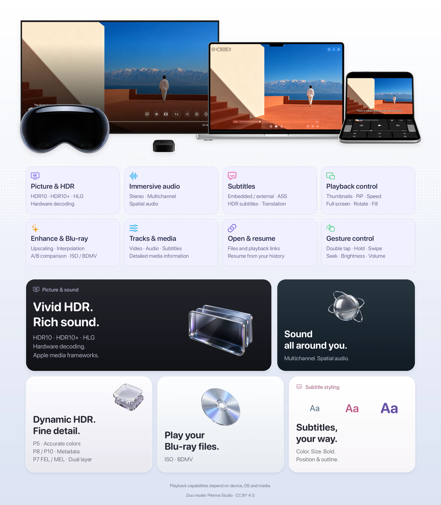

<div align="center">
  <a href="https://cinemore.com.cn/">
    
  </a>
  <h1>CinePlayer for Apple</h1>
  <p><strong>A native video player for your own media</strong></p>
  <p>
    <a href="README.md">English</a> · <a href="README-zh.md">简体中文</a>
  </p>
  <p>
    <a href="https://apps.apple.com/us/app/cineplayer/id6759988668">
      
    </a>
  </p>
</div>

CinePlayer is a standalone video player for iPhone, iPad, Mac, Apple TV and Apple Vision Pro. Open your own videos, adjust subtitles and tracks, and continue from your playback history.

The app layer is open source and built on `CinePlayerSDK`, the playback engine used by **[Cinemore](https://cinemore.com.cn)**. It brings HDR, multichannel and spatial audio, Blu-ray playback and video enhancement to a native interface on each platform.

## 📸 Preview

<p align="center">
  <a href="assets/cineplayer-overview-en.webp"></a>
</p>

The playback image is a demonstration. Add your own media; CinePlayer does not provide films or shows. Playback capabilities depend on the device, OS and media.

Duo device model by [Pikkme Studio](https://sketchfab.com/3d-models/iphone-duo-3d-model-by-pikkme-studio-d2ca6bff92c141d1b1c5759b19d533e0), posed and finished in white under [CC BY 4.0](https://creativecommons.org/licenses/by/4.0/).

## ✨ Features

- **Open & resume**: Local files and playback URLs, with playback history to keep your place. Apple TV opens playback URLs.
- **Image & audio**: HLG, HDR10, HDR10+, Dolby Vision (with RPU); hardware-accelerated decoding; stereo/multichannel, spatial audio, Dolby Atmos where supported.
- **Gestures & shortcuts**: iOS — single tap show/hide controls, double-tap left/right skip or center play/pause, long-press temporary speed (configurable skip seconds and long-press speed in playback settings); tvOS — remote swipe/press skip, long-press continuous seek; macOS — Space play/pause, arrow keys skip/speed, Esc fullscreen, mouse to show controls.
- **Subtitles**: Embedded and local external subtitles; text or bitmap adjustments according to the parsed format; HDR subtitle brightness; Apple Translation on iOS/macOS with target language and bilingual ordering.
- **Tracks & media info**: Detailed video/audio/subtitle track list with quick switching; media info card.
- **Enhancement**: Anime4K, MetalFX, FSR and ArtCNN super-resolution; VideoToolbox, MetalFX and RIFE interpolation; Dolby Vision P7 FEL decoding preference. Availability follows the system, device and video. FSR/ArtCNN require SDR, at most 1080p pixels and 30 fps; RIFE is excluded on tvOS. Super-resolution supports A/B comparison, with original frames displayed during preparation.
- **Playback UX**: Progress scrub with thumbnail preview, picture fill and variable speed; iOS portrait/landscape and orientation lock; picture in picture on supported platforms; macOS fullscreen and always-on-top windows; Now Playing / lock screen & Control Center control where supported.
- **Blu-ray**: ISO and BDMV.
- **Platforms**: iOS, macOS, tvOS, visionOS.
- **Native controls**: tvOS remote menus and subtitle adjustments; a dedicated visionOS playback window, Ornament panels and immersive environment; separate video and console regions on supported iOS 27.1 devices.

**Dolby Vision and Dolby Atmos playback are handled by Apple AVFoundation’s [AVPlayer](https://developer.apple.com/documentation/avfoundation/avplayer/).**

## Installation

### Homebrew Cask (macOS)

```bash
brew install --cask cinemore/tap/cineplayer
```

Starting with v2.0.0, the macOS builds on [GitHub Releases](https://github.com/cinemore/CinePlayer/releases) are signed with Developer ID and notarized by Apple. The same universal app for Apple Silicon and Intel Macs is distributed through Homebrew.

### App Store

For iPhone, iPad, Apple TV, Apple Vision Pro, and the App Store macOS
build, use the App Store link above.

## 🏗 Architecture & Dependencies

### Core Playback Engine (Closed Source)

- **CinePlayerSDK**: The core playback engine of this project.  
  It is a proprietary commercial component distributed in binary form only.
- **Frameworks**: Prebuilt SDK and third-party framework binaries are distributed as [Frameworks.zip in the v2.0.0 release](https://github.com/cinemore/CinePlayer/releases/download/v2.0.0/Frameworks.zip). Download the matching bundle and checksum, verify the download, and extract it into the repository root:

```bash
curl --fail --location -O https://github.com/cinemore/CinePlayer/releases/download/v2.0.0/Frameworks.zip
curl --fail --location -O https://github.com/cinemore/CinePlayer/releases/download/v2.0.0/Frameworks.zip.sha256
shasum -a 256 -c Frameworks.zip.sha256
unzip Frameworks.zip
bun scripts/verify-frameworks.ts
```

After extraction, the repository should contain paths such as `Frameworks/CinePlayerSDK.xcframework` and `Frameworks/CineFFmpeg.xcframework`.

The v2.0.0 bundle includes all 18 XCFrameworks required by this version. The verifier checks device and simulator slices for all four platforms, shutdown, subtitle translation/loading and frame callback interfaces.

The app remains a standalone file/URL player with history, controls, tracks, subtitles and enhancement. Cinemore accounts, libraries, cloud storage, episodes, source switching and casting services are outside its scope.

## 📚 Third-party Libraries

CinePlayer’s capabilities are built on top of the following excellent open-source projects:

### Core multimedia framework

- **[FFmpeg](https://github.com/FFmpeg/FFmpeg)**

### Video & HDR processing

- **[dav1d](https://github.com/videolan/dav1d)** (libdav1d)
- **[dovi_tool](https://github.com/quietvoid/dovi_tool)** (libdovi)
- **[uavs3d](https://github.com/uavs3/uavs3d)** (libuavs3d)
- **[Anime4KMetal](https://github.com/cinemore/anime4k-metal)** 0.1.4
- **[RifeMetal](https://github.com/cinemore/rife-metal)** 0.1.8 (iOS/macOS/visionOS)
- **[FSRMetal](https://github.com/cinemore/fsr-metal)** 0.1.0
- **[ArtCNNMetal](https://github.com/cinemore/artcnn-metal)** 0.1.0

Enhancement licenses ship with the app and are accessible in About → Video Enhancement Licenses.

### Subtitle rendering

- **[libass](https://github.com/libass/libass)**
- **[FreeType](https://github.com/freetype/freetype)**
- **[FriBidi](https://github.com/fribidi/fribidi)**
- **[HarfBuzz](https://github.com/harfbuzz/harfbuzz)**
- **[libunibreak](https://github.com/adah1972/libunibreak)**

### Blu-ray support

- **[libbluray](https://code.videolan.org/videolan/libbluray)**
- **[libudfread](https://code.videolan.org/videolan/libudfread)**

## 🧪 Building & Code Signing

To run on a real iOS device, open the `CinePlayer` iOS target in Xcode, go to **Signing & Capabilities**, and select your own **Team**. Other settings can generally stay as-is for local development.

Prepare the matching `Frameworks.zip` as described in **Architecture & Dependencies**. The current SDK was compiled with Swift 6.4; validation uses Xcode 27. Swift packages are pinned in `Package.resolved`.

For macOS releases, export the archive with Developer ID signing, notarize it, and staple the ticket before creating the ZIP. Run `bun scripts/verify-macos-release.ts v<version> <artifacts-directory>` locally to validate the checksum, app version, signature, and notarization ticket. Upload `CinePlayer-macOS-v<version>.zip`, the matching `Frameworks.zip`, and their `.sha256` files to GitHub Releases, then update the version and checksum in `cinemore/homebrew-tap`'s `Casks/cineplayer.rb`. Publishing and Homebrew updates are performed manually.

The cross-platform `CinePlayerTests` scheme covers real media playback, paused seeks, tracks, subtitle failures, replacement/shutdown, thumbnails and enhancement cleanup, with additional FSR/ArtCNN GPU tests on macOS. The test scheme uses an in-memory history store.

## ⚖️ License

This project uses a **hybrid licensing model**:

- **Source code license**: See the [`LICENSE`](LICENSE) file at the repository root.
- **SDK license**: The binding terms for CinePlayerSDK are in the **License** file inside each platform slice’s `CinePlayerSDK.framework` (on macOS: `Versions/A/Resources/License`). Path: `Frameworks/CinePlayerSDK.xcframework/<platform>/CinePlayerSDK.framework/...`

Third-party libraries (FFmpeg, libass, etc.) are used under their own licenses; see the links in **Third-party Libraries** above.

### 1. Open-source components

The **CinePlayer** application-layer source code is released under the  
**[Apache License 2.0](https://www.apache.org/licenses/LICENSE-2.0)**.  
You are free to study, modify, and build your own applications based on this codebase, subject to the terms of Apache 2.0.

### 2. Proprietary SDK and commercial licensing

**CinePlayerSDK** (distributed as prebuilt binary libraries through GitHub Releases) is proprietary software. The **definitive terms** are in the License file inside the SDK (see path above). You may not reverse engineer, decompile, or disassemble the SDK binaries.

For **this repository only**, the licensor permits:

- **Personal use only**:  
  You may use `CinePlayerSDK` **for personal use only**. No redistribution, sublicense, or commercial use without prior written permission.
- **Commercial use**:  
  **Strictly prohibited** for any third-party company without prior written permission.
- **Commercial license**:  
  Contact `cinemore@cinemore.com.cn` for commercial use or redistribution rights.
